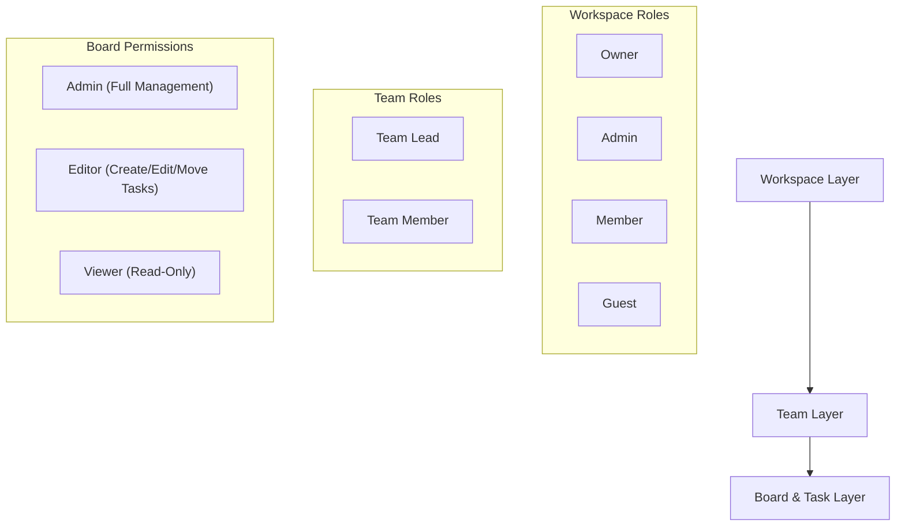

# Mahami Platform — Security & Architecture Model

This document outlines the security architecture, authorization tiers, and threat mitigations implemented across the **Mahami (مهامي)** platform.

---

## 1. Authentication & Session Security

- **Authentication Driver:** Laravel Sanctum with token-based API authentication and stateful SPA cookie support.
- **Password Hashing:** Bcrypt with cost factor 12 (`BCRYPT_ROUNDS=12`).
- **Token Protection:** Tokens are hashed in MariaDB (`personal_access_tokens` table) with expiration and revocation capabilities.
- **Rate Limiting:**
  - `throttle:auth`: Limited to 15 attempts per minute per IP to mitigate credential stuffing and brute-force attacks.
  - `throttle:api`: Limited to 120 requests per minute per authenticated user (or IP) to mitigate resource exhaustion / DoS.

---

## 2. Multi-Tier Authorization Model (RBAC)

The system enforces three distinct, hierarchical authorization layers:

### 2.1 Workspace Level
- **Owner:** Full ownership, transfer ownership, billing, member deletion, workspace deletion.
- **Admin:** Manage teams, invite members, change member roles, update workspace metadata.
- **Member:** Create and view boards scoped to the workspace, join assigned teams.
- **Guest:** Read-only access to explicitly assigned boards.

### 2.2 Board & Task Level
- Access is strictly resolved via `Board::getUserPermission(User $user)`:
  1. Direct board ownership (`user_id === user.id`) yields `admin`.
  2. Workspace owner or workspace admin yields `admin`.
  3. Team assignments in `board_teams` resolve to `admin`, `editor`, or `viewer`.
  4. Unassigned workspace members default to `editor` if board has no restrictive teams.
- Policies enforcing this model:
  - `WorkspacePolicy`
  - `TeamPolicy`
  - `BoardPolicy`
  - `BoardListPolicy`
  - `TaskPolicy`
  - `TaskCommentPolicy`

---

## 3. Multi-Tenant Data Isolation

- All queries for boards, lists, tasks, comments, and analytics are filtered by authenticated user or workspace membership.
- Foreign ID verification prevents IDOR (Insecure Direct Object Reference): moving tasks between columns on different boards or reordering with foreign IDs is rejected with HTTP 403 / 422.
- Verified in automated test: `SecurityAndPerformanceTest::test_strict_tenant_isolation_prevents_cross_workspace_data_leaks`.

---

## 4. Input Sanitization & Threat Mitigations

| Threat | Mitigation Strategy | Implemented Mechanism |
|---|---|---|
| **SQL Injection** | Parameterized queries | Eloquent ORM & PDO prepared statements across all controllers and repositories |
| **XSS (Cross-Site Scripting)** | HTML escaping & sanitization | Vue 3 automatic template interpolation escaping (`{{ }}`), server validation |
| **CSRF** | Token validation | Laravel Sanctum CSRF cookie verification for stateful requests |
| **File Upload Exploits** | Strict MIME & extension validation | Laravel FormRequest file rules (`file|max:20480`), unique storage naming |
| **N+1 Query Overload** | Eager loading | Repository pattern loads `lists.tasks.assignees.labels.checklists` in constant query count |
| **Information Disclosure** | API Resources | Explicit resource filtering prevents leaking hidden database fields |

---

## 5. Security Incident Response & Audit Trail

- All critical actions (creation, movement, assignment, comments, uploads) are immutably logged into `activity_logs` with actor ID, timestamp, and metadata for forensics and compliance.

